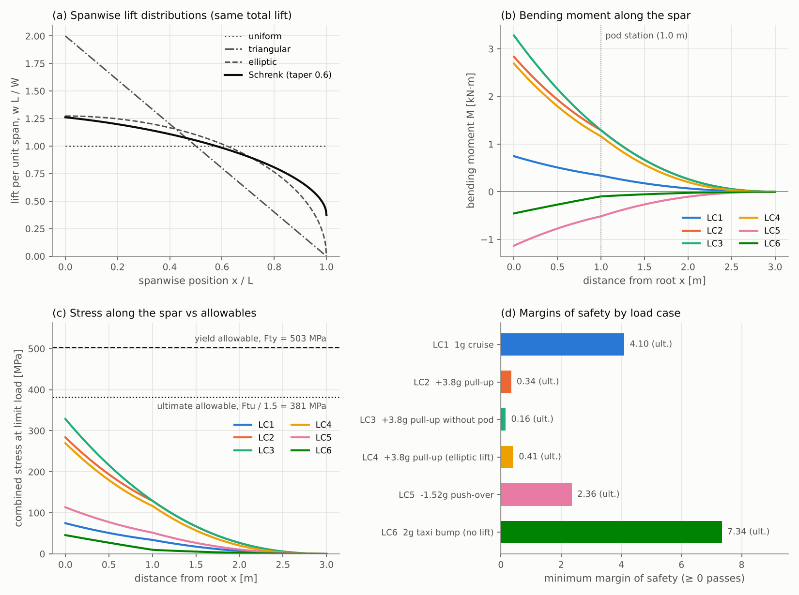
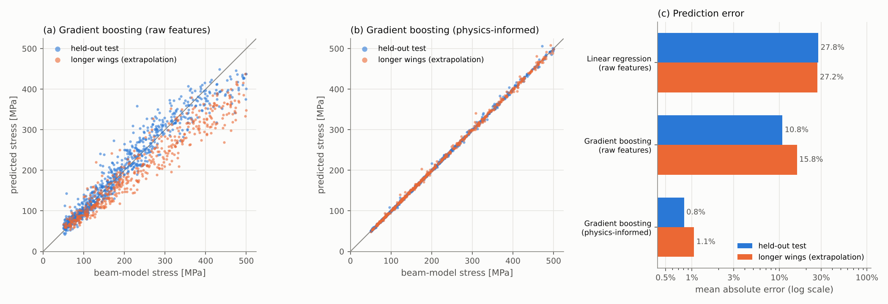

# Aerospace Structural Load Analyzer

This project demonstrates a simplified, extensible framework for analysing structural loads
and estimating stresses in aerospace components using Python.

The goal is not high-fidelity FEM, but clean software architecture, engineering reasoning,
and data-driven extensibility aligned with modern aerospace workflows.

The worked example sizes the wing spar of a small (150 kg) fixed-wing UAV against a set
of flight and ground load cases, then trains a machine-learning model to predict spar
stress directly from design parameters.



## Features

* **Object-oriented beam and material modelling.** `Material` objects come from a CSV
  library. Tube, rectangular and I-beam cross-sections share one `Section` interface,
  and the cantilever beam accepts any distributed load plus point loads.
* **Analytical stress estimation.** Shear force, bending moment, bending and shear
  stress, combined stress, slope and deflection along the span. Validated against
  closed-form textbook solutions.
* **Data pipeline for load cases.** The aircraft is defined in a JSON file and the load
  cases in a CSV file. The pipeline runs every case and produces a pandas results
  table with yield and ultimate margins of safety and a pass/fail flag.
* **Machine-learning stress prediction (concept demonstration).** scikit-learn models
  are trained on thousands of designs labelled by the beam model. Models using raw
  features are compared with a physics-informed model on unseen designs and on
  longer wings than any seen in training.
* **Clean, modular architecture.** Each engineering concern lives in its own module,
  and pytest checks every formula.

## Technologies

* Python
* NumPy, SciPy, pandas
* scikit-learn
* Matplotlib
* pytest

## Engineering model

**Wing as a cantilever.** Each half-wing spar is fixed at the fuselage. For a load
factor *n* it carries three loads:

| Load | Model |
|---|---|
| Lift, n · MTOW · g / 2 per half-wing | spread along the span by a chosen distribution |
| Wing structure inertia | −n · g · (wing mass per metre), uniform along the span |
| Wing-mounted pod inertia | −n · g · (pod mass), a point load at the pod station |

**Lift distributions** (`aerostruct/loads.py`) are uniform, triangular, elliptic and
**Schrenk's approximation**. Schrenk's method averages the elliptic and planform-shaped
loading and is a standard quick estimate for preliminary sizing of an unswept tapered wing.

**Beam theory** (`aerostruct/beam.py`) uses Euler–Bernoulli theory. Shear and moment
come from equilibrium of the outboard segment, integrated numerically so that any lift
shape works. Point loads are added exactly. The deflection comes from v″ = M / EI.

| Quantity | Expression |
|---|---|
| Bending stress | σ = M c / I |
| Peak shear stress (neutral axis) | τ = V Q / (I b) |
| Combined stress | √(σ² + 3τ²), conservative because peak σ and τ occur at different fibres |
| Margin of safety, yield (limit load) | Fty / σ − 1 |
| Margin of safety, ultimate (1.5 × limit) | Ftu / (1.5 σ) − 1 |

## Example: 150 kg UAV wing spar

The configuration is in `data/aircraft.json`:
* 3.0 m half-span and a taper ratio of 0.6.
* Wing structure of 2.5 kg/m.
* A 12 kg pod 1.0 m outboard on each wing.
* The spar is an **Al 7075-T6 tube, 75 × 2.5 mm** (1.6 kg/m).

The load cases are in `data/load_cases.csv`. The manoeuvre load factors (+3.8 g / −1.52 g)
are the CS-23 normal-category limits, used here as representative values.

| Case | Description | n | Root moment [N·m] | Peak stress [MPa] | Tip deflection [mm] | MS yield | MS ultimate |
|---|---|---|---|---|---|---|---|
| LC1 | 1 g cruise | 1.0 | 746 | 75 | 61 | 5.73 | 4.10 |
| LC2 | +3.8 g pull-up | 3.8 | 2,834 | 284 | 234 | 0.77 | 0.34 |
| **LC3** | **+3.8 g pull-up, pod not fitted** | 3.8 | **3,281** | **329** | 256 | 0.53 | **0.16** |
| LC4 | +3.8 g pull-up, elliptic lift | 3.8 | 2,692 | 270 | 214 | 0.86 | 0.41 |
| LC5 | −1.52 g push-over | −1.52 | −1,134 | 114 | −93 | 3.43 | 2.36 |
| LC6 | 2 g taxi bump, no lift | 2.0 | −456 | 46 | −30 | 10.00 | 7.34 |

All cases pass. Ultimate strength governs every case. Some observations:

* **The critical case is the pull-up without the pod.** The pod's weight acts against
  the lift and relieves the root bending moment. Removing the pod while keeping the same
  aircraft mass (the payload moves to the fuselage) raises the root moment by 16% and
  cuts the margin from 0.34 to 0.16. This is why load-case tables include
  configuration variants, not only load factors.
* **The choice of lift distribution matters.** The Schrenk estimate puts more lift
  outboard than an ideal elliptic distribution and gives a 5% higher root moment
  (LC2 against LC4). Assuming elliptic loading would be slightly unconservative.
* **The kink in the moment and stress curves at 1.0 m** is the pod point load.
* **Deflection is large.** A tip deflection of about 8.5% of the half-span at limit load
  is near the edge of small-deflection theory, so the stiffness of a real design would
  need a closer look.

## Machine-learning stress prediction

`scripts/train_stress_model.py` generates **4,000 plausible wing and spar designs**
by randomising nine parameters:
* load factor, MTOW and half-span;
* taper ratio and wing mass per metre;
* pod mass and pod station;
* tube diameter and wall thickness.

Designs with wings and pods over 40% of MTOW, or with a limit stress outside 50–500 MPa,
are discarded. The beam model labels each design with its peak combined stress.
Three regressors are trained on 3,200 designs. They are tested on the other 800, and
on 500 designs with **longer wings (4.5–6 m half-span) than any in training**.



| Model | Test MAPE | Test R² | Extrapolation MAPE | Extrapolation 95th pct. error |
|---|---|---|---|---|
| Linear regression, raw features | 27.8% | 0.836 | 27.2% | 85% |
| Gradient boosting, raw features | 10.8% | 0.945 | 15.8% | 31% |
| **Gradient boosting, physics-informed** | **0.8%** | **0.999** | **1.1%** | **3.3%** |

**Physics-informed** here means:
1. Simple beam theory gives a nominal stress, S = (n · MTOW · g / 2) · L / Z.
2. The model only learns the correction factor σ / S, from dimensionless inputs: taper,
   pod mass ratio, pod station, wing mass ratio, wall-to-diameter and span-to-diameter.

**What this shows**

* **Feature engineering based on physics beats model complexity.** Gradient boosting on
  raw inputs has to rediscover that stress scales with load × span / section modulus.
  It never quite does, and it gets worse on longer wings: in panel (a) it under-predicts
  most of them. Building that scaling into the inputs cuts the error by more than 10×
  and holds up outside the training range.
* **Linear regression** on raw inputs, which the earliest version of this project used,
  cannot represent the multiplicative physics at all.
* **Limitation:** the surrogate is only as good as the model that labelled its data.
  Here that is simple beam theory. With FE or test data as labels, the same pipeline
  would carry those models' fidelity instead.

## Validation

`pytest` runs 14 checks against closed-form results:

| Check | Reference |
|---|---|
| Tip point load | root moment PL, tip deflection PL³ / 3EI |
| Uniform load | M(x) = w(L − x)² / 2 along the span, tip deflection wL⁴ / 8EI |
| Triangular load (peak at root) | root moment WL / 3, tip deflection w₀L⁴ / 30EI |
| Elliptic load | resultant acts at 4L / 3π from the root |
| Point load part-way along the span | tip deflection Pa²(3L − a) / 6EI, zero shear outboard |
| Superposition | combined load = sum of individual responses |
| Lift distributions | each integrates to the requested total lift |
| Sections | tube and rectangle formulas, thin-tube shear τ → 2V / A, I-beam reduces to a rectangle |

## Quick start

```bash
pip install -r requirements.txt
pytest                                   # 14 validation tests
python scripts/run_load_cases.py         # load-case table, results CSV, docs/load_cases.png
python scripts/train_stress_model.py     # ML demo, ~5 s, docs/ml_stress_prediction.png
```

You can also use the library directly:

```python
from aerostruct import CantileverBeam, Tube, load_library, loads

al = load_library()["Al 7075-T6"]
spar = CantileverBeam(3.0, Tube(0.075, 0.0025), al)
r = spar.analyse(loads.schrenk(2800, 3.0, taper=0.6), point_loads=[(1.0, -450)])
x, s = r.critical()
print(f"root moment {r.root_moment:.0f} N m, peak stress {s / 1e6:.0f} MPa, "
      f"tip deflection {r.tip_deflection * 1e3:.0f} mm")
# root moment 3257 N m, peak stress 326 MPa, tip deflection 269 mm
```

To analyse your own aircraft, edit `data/aircraft.json`. To add load cases, add rows to
`data/load_cases.csv`. To add materials, add rows to `data/materials.csv`.

## Project layout

```
aerostruct/
  materials.py   Material dataclass + CSV material library
  sections.py    Section interface: Tube, Rectangle, IBeam
  loads.py       spanwise lift distributions (uniform, triangular, elliptic, Schrenk)
  beam.py        cantilever beam: V, M, stresses, deflection
  analysis.py    aircraft config, load-case pipeline, margins of safety
  ml.py          dataset generation, raw vs physics-informed regressors
  plotting.py    shared chart styling
data/            aircraft.json, load_cases.csv, materials.csv
scripts/         run_load_cases.py, train_stress_model.py
tests/           validation against closed-form solutions
results/         generated results tables and metrics
docs/            README figures
```

## Assumptions and limitations

* Euler–Bernoulli beam with small deflections and a constant cross-section along the span.
* The spar alone carries the bending. There is no load sharing with the skins, and no
  torsion, drag loads or buckling checks. The compression side of a real spar or skin
  would also need a stability check.
* Material values are typical handbook figures, **not** A- or B-basis design allowables.
* Load factors are representative. A real programme derives them from the certification
  basis, the flight envelope and gust analysis.

## Motivation

Inspired by aerospace structural analysis workflows and an interest in digital continuity
and AI-assisted engineering.

## Future extensions

* Coupling with FEM solvers, for example using FE results as higher-fidelity training labels.
* Spanwise-tapered spars, torsion and skin buckling checks.
* Digital twin integration: updating load cases from flight or test data.
* Uncertainty quantification: material scatter and load variability through
  Monte Carlo simulation over the pipeline.
